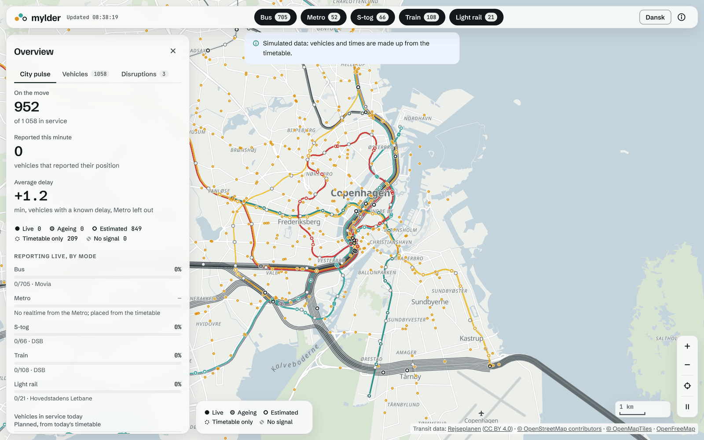

# Mylder

**Watch Copenhagen move.** A live map of the city's buses, S-tog, metro and regional trains, and honest about how fresh each position is.

_Mylder_ is Danish for a teeming crowd, and it echoes _myldretid_, rush hour.

**Demo:** [marcin-sieradzki.github.io/mylder](https://marcin-sieradzki.github.io/mylder/) runs the whole app on simulated data, with the server's tracker in a Web Worker in your browser.

<picture>
  <source media="(prefers-color-scheme: dark)" srcset="docs/images/map-dark.png">
  
</picture>

> **Status:** every screen of the first public version is built, and runs on a simulated Rejseplanen until the API key arrives. Going live on the real API and deploying to Vercel come next. See the [roadmap](#roadmap).

## Why

Trip planners like Rejseplanen, Citymapper and Google Maps tell you how to get somewhere. None of them shows the whole city moving at once. Mylder is for that view first, with useful info (departures, delays, disruptions) one tap away.

## Honest data states

Live transit data is patchy: some vehicles report their position, some are only estimated, some have no realtime at all, and answers stop coming. Mylder never hides which is which. Every vehicle and departure carries one of these states:

| State          | Meaning                                                                          | Example label             |
| -------------- | -------------------------------------------------------------------------------- | ------------------------- |
| Live           | Reported by the vehicle, within about two polls                                  | "Reported 20 s ago"       |
| Ageing         | Reported, but older than that and under 5 min                                    | "Last seen 3 min ago"     |
| Estimated      | Computed by Rejseplanen, or worked out by Mylder from the timetable and realtime | "Estimated from schedule" |
| Timetable only | No realtime for this trip today, like every Metro train                          | "Timetable only"          |
| No signal      | Had realtime, then missing for 5 min                                             | "No signal since 10:42"   |

On the map, reported positions are solid dots and estimated ones are hollow. A position Rejseplanen computes is never shown as Live. Thresholds are first guesses until real coverage is measured. The full rules are in [`docs/data-states.md`](docs/data-states.md), and the words in [`GLOSSARY.md`](GLOSSARY.md).

## How it works

```
Rejseplanen API ──▶ one Next.js app ──────────CDN──▶ browsers
 (positions,         one call a minute while        poll one snapshot,
  departures,        someone watches; joins it      animate vehicles
  disruptions)       to the Labs GTFS timetable     along their paths
```

The free Rejseplanen key allows about one call a minute, so browsers never call the API. The app's server makes that call only while someone is watching, joins the answer to a timetable prepared from Rejseplan Labs GTFS, decides each trip's data state, and serves one snapshot of the whole city through the CDN. Every browser polls that snapshot and moves each vehicle along its path until the next one. Until the key arrives, a simulated Rejseplanen answers in its place: it builds the same API answers from the timetable, so the tracker, the snapshot and every screen run exactly as they will on real data, and every screen says the data is simulated. One environment variable, `MYLDER_SOURCE`, picks the simulation, a recording or the real API ([`docs/testing-seams.md`](docs/testing-seams.md)). The decisions and their reasons are in [`docs/adr/`](docs/adr/); the plumbing in [`docs/live-data.md`](docs/live-data.md), [`docs/timetable.md`](docs/timetable.md) and [`docs/screens.md`](docs/screens.md).

## Roadmap

**First public version**

- [x] App shell: Next.js, React 19, TypeScript, Vitest, Playwright, CI
- [x] The timetable, prepared from the Labs GTFS and refreshed by a scheduled job
- [x] A simulated Rejseplanen to build and test against until the key arrives
- [x] The tracker: one call a minute while someone watches, one snapshot of the whole city
- [x] Live map with every vehicle moving along its route (MapLibre GL + deck.gl)
- [x] Vehicle detail and stop departures, each with its data state
- [x] City pulse: vehicles moving now, share reporting per mode, average delay when the data backs it, and the day's planned profile
- [x] Vehicles list: every vehicle on the map in a searchable table, sortable by its columns
- [x] Disruptions on one screen, and an About dialog with the sources and their terms
- [x] English and Danish, light and dark, mobile first
- [x] A simulated demo on GitHub Pages
- [ ] Go live on the real Rejseplanen API, once the key arrives
- [ ] Deploy production and previews on Vercel, with the tracker's state in a hosted Redis

**Later:** harbour ships from AIS, car traffic flow, replay of a past rush hour, a full-screen kiosk mode, more cities.

## Stack

- [Next.js 16](https://nextjs.org) with the App Router, [React 19](https://react.dev) and TypeScript
- [Perron](https://github.com/marcin-sieradzki/perron), Mylder's own design system, for every component and token ([docs](https://marcin-sieradzki.github.io/perron/))
- [MapLibre GL](https://maplibre.org) for the basemap and [deck.gl](https://deck.gl) for the vehicles
- [Effect](https://effect.website) for the server's tracker
- [Vitest](https://vitest.dev) + Testing Library for unit and component tests, with Vite only as Vitest's compiler
- [Playwright](https://playwright.dev) for end-to-end tests
- [oxlint](https://oxc.rs/docs/guide/usage/linter) for linting, [Prettier](https://prettier.io) for formatting
- Agent skills in `.claude/skills/`: `grill-me`, `grilling`, `wayfinder` (with `domain-modeling`, `prototype` and `research`), `to-spec`, `to-tickets`, `implement-spec` (with `tdd`, `codebase-design` and `code-review`), `improve-codebase-architecture` and `software-factory` from [mattpocock/skills](https://github.com/mattpocock/skills) (MIT), and `vercel-react-best-practices` from [vercel-labs/agent-skills](https://github.com/vercel-labs/agent-skills) (MIT)
- Planned: Vercel for deploys and Upstash Redis for the tracker's state

## Getting started

Requires Node 22 or newer.

```sh
npm install
npm run dev
```

It runs on the simulated Rejseplanen, so no API key is needed. The interface lives at `/en` and `/da`; `/` sends a visit to the language its browser asks for, English when it asks for neither.

Before the first e2e run, install a browser with `npx playwright install chromium`.

| Script                  | What it does                                   |
| ----------------------- | ---------------------------------------------- |
| `npm run dev`           | Start the Next.js dev server                   |
| `npm run build`         | Build for production into `.next/`             |
| `npm start`             | Serve the production build                     |
| `npm run check`         | Type-check, lint, format check and unit tests  |
| `npm run typecheck`     | Type-check with `tsc`                          |
| `npm run test`          | Run unit tests once                            |
| `npm run test:watch`    | Run unit tests in watch mode                   |
| `npm run test:coverage` | Run unit tests with coverage                   |
| `npm run test:e2e`      | Build, serve and run Playwright tests          |
| `npm run demo`          | Build the GitHub Pages demo into `out/`        |
| `npm run demo:serve`    | Serve the built demo as GitHub Pages does      |
| `npm run test:e2e:demo` | Run the demo's Playwright tests on its build   |
| `npm run recordings`    | Freeze the test recordings from the simulation |
| `npm run timetable`     | Prepare the timetable from the Labs GTFS       |
| `npm run lint`          | Lint with oxlint                               |
| `npm run format`        | Format everything with Prettier                |

## Folders

Each folder's name says where its code may run. Three are guarded, so a wrong import fails the build or the lint:

| Folder           | Runs on                    | What it holds                                         | Guard                                                  |
| ---------------- | -------------------------- | ----------------------------------------------------- | ------------------------------------------------------ |
| `app/`           | Server                     | Next.js routes and route handlers, kept thin          |                                                        |
| `src/domain/`    | Both                       | Pure rules: data states, positions, delays            | `npm run lint` fails on any import from another folder |
| `src/tracker/`   | Server only                | The Effect tracker behind the snapshot                | `server-only`: `next build` fails in a client module   |
| `src/timetable/` | Both                       | The prepared timetable's format and readers           |                                                        |
| `src/map/`       | Browser only               | MapLibre, the deck.gl layer and the animation loop    | `client-only`: `next build` fails in a server module   |
| `src/screens/`   | Browser                    | Client components for the screens, built from Perron  |                                                        |
| `src/i18n/`      | Both, loader on the server | English and Danish dictionaries and the language type |                                                        |
| `src/demo/`      | Web Worker, demo only      | The simulated tracker of the GitHub Pages demo        |                                                        |

Tests sit beside the code they test; Playwright journeys are in `e2e/`, and the timetable job in `scripts/timetable/`.

## Data

Transit data from [Rejseplanen Labs](https://labs.rejseplanen.dk), used under its non-commercial guidelines. API keys stay on the server and are never committed.

## About

Built by [Marcin Sieradzki](https://github.com/marcin-sieradzki), a frontend and AI engineer in Copenhagen.
