# Perron: building an AI-native design system

Research for Mylder, 2026-10-23. Living version: https://claude.ai/artifact/RkmMXC3WoaWbsc42qvaN5w

## Summary

An AI-native design system is an ordinary good design system whose source of truth is machine-readable, plus a thin layer that hands that truth to agents. For Perron, that means one token file in the W3C format, React 19 components with typed props and written usage rules, and a small MCP server and agent skill built from those same files.

The five decisions that matter most for Mylder:

1. **Tokens first, in the DTCG 2025.10 format.** One JSON source builds CSS variables and syncs to Figma variables. Colour stays reserved for transit lines and delay semantics, as in the prototype.
2. **Make the data-state dots a first-class primitive.** The five Prik dot states (live, ageing, estimated, timetable, no signal) are Mylder's signature. They get their own token group, component, spec and tests.
3. **Every component ships a spec file next to its code:** purpose, when to use and when not to, props, states, accessibility notes, do and don't examples. Docs, Storybook, the MCP server and the agent skill are all generated from it.
4. **Connect Figma to code with Code Connect and the Figma MCP server,** so an agent reading a Figma frame gets the real `@perron/react` import, not a guess.
5. **Measure it.** A small eval suite of prompts ("build a departures board") checks that agents use Perron components and tokens, with no raw hex values or invented components.

Research caveat: the research environment could not open Figma's, Storybook's or most vendor pages directly, so facts below come from search results and their quoted passages. The Sources section marks which is which.

## What a good design system needs

A design system is good when people and agents can build a correct screen without asking anyone. These are the parts that make that possible, with what each means for Perron.

| Part          | What good looks like                                                                                                                                                                                                     | Perron specifics                                                                                                                 |
| ------------- | ------------------------------------------------------------------------------------------------------------------------------------------------------------------------------------------------------------------------ | -------------------------------------------------------------------------------------------------------------------------------- |
| Tokens        | Three tiers: primitives (raw values), semantic (`color.text.muted`, `color.delay.severe`), component (`departure-row.gap`). Code and design consume only semantic and component tokens. Modes for light, dark and kiosk. | Line colours (M1 to M4, S-tog A to H, buses) are data-driven tokens. Ink-only chrome. Data-state opacity and stroke tokens.      |
| Foundations   | Type scale, spacing scale, radius, elevation, motion, grid, iconography, written as tokens plus a short rationale.                                                                                                       | Familjen Grotesk, Schibsted Grotesk, JetBrains Mono for times. Tabular figures for countdowns.                                   |
| Components    | Small primitives first, then composites. Typed props, controlled and uncontrolled modes, every state designed (loading, empty, error, stale).                                                                            | Dot glyph, line badge, departure row, stop card, disruption banner, vehicle popover, map controls.                               |
| Patterns      | Recipes for whole tasks, built from components.                                                                                                                                                                          | Honest data states, realtime updates, disruptions, offline and feed outage.                                                      |
| Content       | Voice, tone, terminology and i18n rules.                                                                                                                                                                                 | EN/DA from day one. Fixed words for data states ("Live", "Estimated", "Scheduled").                                              |
| Accessibility | WCAG 2.2 AA as the floor, tested per component: contrast, focus, keyboard, screen reader names, reduced motion, no meaning by colour alone.                                                                              | The dot glyphs already encode state by shape as well as opacity, which is the right call. Live regions for countdowns need care. |
| Docs          | One page per component: purpose, when not to use it, anatomy, props, examples, a11y notes. Live examples beat screenshots.                                                                                               | Storybook as the workshop, docs generated from specs.                                                                            |
| Quality       | Visual regression, a11y checks (axe) and unit tests in CI. Lint rules that ban raw values.                                                                                                                               | Stylelint and ESLint rules that block hex colours and magic pixel values outside the token package.                              |
| Versioning    | Semantic versioning, changesets, a changelog, deprecations announced one minor release before removal, codemods for breaking changes.                                                                                    | Monorepo with independent packages: `@perron/tokens`, `@perron/react`, `@perron/icons`.                                          |
| Governance    | A named owner, a contribution path (proposal, review, release), and a rule for when something becomes a system component (used in two or more places).                                                                   | Solo maintainer for now, so keep it light: a CONTRIBUTING file and a proposal issue template.                                    |

The parts that most often fail in practice are states (designs show only the happy path) and docs that say what a component is but not when to avoid it. Both matter even more for agents, which follow written rules literally.

## What AI-native means, and the tools that exist now

AI-native means an agent can discover what exists, read the rules, use the real thing, and be checked. Agents fail on design systems in four predictable ways: they invent components, hardcode values, pick the wrong variant, and skip states. Each tool below closes one of those gaps.

| Tool                                                                                                                                                 | What it gives an agent                                                                                                                                                   | Status (Oct 2026)                                                                                     |
| ---------------------------------------------------------------------------------------------------------------------------------------------------- | ------------------------------------------------------------------------------------------------------------------------------------------------------------------------ | ----------------------------------------------------------------------------------------------------- |
| [DTCG Design Tokens Format 2025.10](https://www.w3.org/community/design-tokens/2025/10/28/design-tokens-specification-reaches-first-stable-version/) | One standard JSON shape for tokens that Figma, Style Dictionary and agents all read                                                                                      | First stable version, Oct 2025. A Community Group report, not a W3C Standard                          |
| Figma variables, modes and JSON export                                                                                                               | Tokens inside Figma, with light, dark and other modes. Native JSON import and export in DTCG shape                                                                       | Export rolled out late 2025. Reported gap: descriptions are not exported                              |
| [Figma MCP server](https://github.com/figma/mcp-server-guide)                                                                                        | Design context for a frame: layout, variables, components. Tools include `get_design_context`, `get_variable_defs`, `get_code_connect_map`, `create_design_system_rules` | Generally available. Remote server at mcp.figma.com plus a desktop server. Write-to-canvas is in beta |
| Code Connect                                                                                                                                         | Maps each Figma component to its code component, so the MCP output includes the real import and props                                                                    | CLI and an in-Figma UI linked to GitHub. Paid plans, Full or Dev seat                                 |
| [Storybook MCP and manifests](https://storybook.js.org/docs/ai)                                                                                      | A JSON manifest of components, props and stories, served over MCP at `/mcp` by the dev server                                                                            | Preview, React only                                                                                   |
| [shadcn registry and MCP](https://ui.shadcn.com/docs/mcp)                                                                                            | A way to publish components as installable source, which agents can search and add                                                                                       | Stable, widely used                                                                                   |
| llms.txt                                                                                                                                             | A Markdown index of the docs, sized so an agent can choose what to fetch                                                                                                 | Convention, not a standard                                                                            |
| AGENTS.md, CLAUDE.md, agent skills                                                                                                                   | Written rules and step-by-step procedures the agent loads when it works in a repo                                                                                        | Supported by Claude Code and most coding agents                                                       |
| A custom design-system MCP server                                                                                                                    | Tools like `list_components`, `get_component`, `search`, `get_tokens` that answer from the spec files                                                                    | Pattern used by Appian Aurora, Knapsack and others                                                    |

The evidence on what works is still thin. A [July 2026 survey of about 20 open-source design systems](https://github.com/kaelig/state-of-ai-in-design-systems) found that almost none ship llms.txt, Code Connect or agent instruction files, and zeroheight's 2026 report found about one in ten teams has AI in the process. The repeated lesson is to ground agents in the existing source of truth rather than writing separate AI docs, and to keep a human review gate.

## AI-native in Figma

The Figma file should be structured so the MCP server returns clean, named data instead of raw frames. That is mostly discipline, not new features.

1. **Variables for every value.** Colour, spacing, radius, type and opacity live in variable collections that mirror the token tiers: a Primitives collection, a Semantic collection with Light, Dark and Kiosk modes, and a Lines collection for transit line colours. Scope each variable (fill, stroke, gap) so designers cannot apply a spacing value as a colour. Names match code exactly, for example `color/delay/severe` in Figma and `--perron-color-delay-severe` in CSS.
2. **Write descriptions on variables and components.** Agents read them through the MCP server. Since Figma's DTCG export reportedly drops descriptions, the token JSON in the repo stays the source of truth and Figma is synced from it.
3. **Components mirror the React API.** Variant properties use the same names and values as props (`state=live|ageing|estimated|scheduled|nosignal`), booleans become boolean properties, and text becomes text properties. No detached instances, and auto layout everywhere so the MCP layout output maps to flexbox.
4. **Code Connect for every published component.** Each Figma component links to its `@perron/react` file, with a mapping of variant properties to props. Without it, the MCP server still sends styles, but the agent writes new markup instead of importing Perron.
5. **Run `create_design_system_rules` once** and commit the output to the repo's agent rules, then edit it by hand. It is a quick first draft of the conventions file.
6. **Use write-to-canvas carefully.** Agents can now draw in Figma through the remote MCP server, which is useful for generating screen variants from real components. Keep it on drafts pages while it is in beta.

Plan note: Code Connect and the Dev Mode tools need a paid Figma plan with a Full or Dev seat. The free Starter plan limits variables to one mode per collection. Penpot (open source, native DTCG tokens, has an MCP server) is a free alternative worth evaluating.

## AI-native in code

In code, the rule is one spec file per component that every other output is generated from. Agents then read the same truth whether they use the MCP server, Storybook, llms.txt or the docs site.

**Components (React 19).**

- TypeScript with JSDoc on every prop. Agents and Storybook's manifest both read prop descriptions, so "Delay in whole minutes; null means no realtime data" beats a bare `delay?: number`.
- Use React 19 idioms: `ref` as a plain prop (no `forwardRef`), `use()` and Suspense for async data, and `useOptimistic` only where it fits. Keep components free of data fetching so they work in any app.
- Styling through CSS variables from `@perron/tokens`, with CSS modules or vanilla-extract. Avoid runtime CSS-in-JS. Plain CSS variables are also what agents handle most reliably.
- Compound components for composites (`<StopCard>`, `<StopCard.Departures>`) and a small set of strict variants rather than open style props.

**The spec file.** Next to each component, a `button.spec.md` (or YAML) holds: purpose, when to use, when not to use and what to use instead, props, states, accessibility contract, content rules, and two or three canonical examples. Tests can check that every prop in the TypeScript type is documented.

**Agent-facing outputs, all generated in CI:**

| Output                                                                                                  | Built from                                        | Used by                                                                 |
| ------------------------------------------------------------------------------------------------------- | ------------------------------------------------- | ----------------------------------------------------------------------- |
| `llms.txt` and `llms-full.txt` on the docs site                                                         | Specs and token docs                              | Any agent with web access                                               |
| `@perron/mcp` server: `list_components`, `get_component`, `search_docs`, `get_tokens`, `validate_usage` | Specs, tokens, the TypeScript types               | Claude Code, Cursor, VS Code                                            |
| Storybook manifest and MCP addon                                                                        | Stories and prop types                            | Agents working inside the repo                                          |
| Agent skill `perron-ui` (SKILL.md)                                                                      | Hand-written rules plus generated component index | Claude Code and other skill-aware agents in Mylder and in Perron itself |
| `AGENTS.md` and `CLAUDE.md` in both repos                                                               | Hand-written                                      | Every agent session                                                     |
| shadcn-style registry (optional)                                                                        | Component source                                  | People who want to copy source rather than install a package            |

The `validate_usage` tool is the one most systems lack: give it a snippet of JSX and it returns rule violations (raw hex, unknown component, missing accessible name, a `DataStateDot` without a state). It reuses the same lint rules as CI.

**Evals.** Keep 15 to 30 realistic prompts, such as "build a stop screen with five departures, one cancelled" or "show a bus whose GPS is three minutes old". Run them with an agent against the repo, then score the output automatically: Perron imports used, zero raw values, type check passes, axe passes, and a screenshot compared with a reference. Run the suite when specs, the skill or the MCP server change, and track the pass rate per release.

## Recommended architecture for Perron

Three hand-edited sources produce everything else, so Figma, the docs and the agents can never drift apart without CI noticing.

```mermaid
flowchart LR
  subgraph Source["Source of truth (edited by hand)"]
    T["tokens.json<br/>DTCG 2025.10, all modes"]
    S["Component specs<br/>one spec.md each"]
    R["React 19 source<br/>typed, documented props"]
  end
  subgraph Gen["Generated in CI"]
    C["CSS variables<br/>@perron/tokens"]
    F["Figma variables<br/>synced from tokens.json"]
    D["Docs and llms.txt"]
    SB["Storybook manifest"]
    M["@perron/mcp and skill"]
  end
  subgraph Use["Consumers"]
    DS["Designers in Figma<br/>Code Connect to React"]
    A["Mylder app<br/>imports packages only"]
    AG["Coding agents<br/>MCP, skill, evals"]
  end
  Source -- build --> Gen -- use --> Use
```



A suggested layout for the public Perron repo, as a pnpm monorepo:

```
perron/
  AGENTS.md            rules for any agent working in this repo
  CLAUDE.md            points to AGENTS.md plus Claude-specific notes
  packages/
    tokens/            tokens.json (DTCG), Style Dictionary build to CSS and TS
    react/             components, each with .tsx, .module.css, .spec.md, .stories.tsx, .test.tsx
    icons/             SVG sources and generated React icons
    mcp/               MCP server reading specs, tokens and types
    eslint-plugin/     rules that ban raw values and unknown components
  skills/perron-ui/    SKILL.md and generated component index
  apps/docs/           docs site, serves llms.txt and llms-full.txt
  figma/               Code Connect files and the token sync script
  evals/               prompts, scoring scripts, reference screenshots
```

Mylder then depends on `@perron/tokens` and `@perron/react` from npm, installs the `perron-ui` skill and the `@perron/mcp` server, and keeps no styling of its own beyond layout.

## Roadmap for Mylder

Build the AI layer in step with the components, not after them: each phase ends with something an agent can already use.

1. **Inventory and tokens.** Extract every component from the prototype. Turn its colours, type and spacing into `tokens.json` with Light, Dark and Kiosk modes. Done when the prototype can be restyled from the token file alone.
2. **Core primitives with specs.** DataStateDot, LineBadge, Text, Button, IconButton, Badge, Tooltip and Sheet, each with a spec, stories and tests. Add AGENTS.md, the ESLint rules and the first llms.txt. Done when an agent can build a departure row from specs alone.
3. **Composites and Figma link.** DepartureRow, StopCard, DisruptionBanner, VehiclePopover and map controls. Sync tokens to Figma variables and add Code Connect for every component. Done when the Figma MCP server returns `@perron/react` imports for a Mylder frame.
4. **Agent layer.** Ship `@perron/mcp` with `validate_usage`, the `perron-ui` skill and the first 15 eval prompts. Done when the eval pass rate is recorded per release.
5. **Public release.** Docs site, changesets, semantic versioning, CONTRIBUTING and a 1.0 tag. Mylder consumes Perron from npm.

Open questions:

- [ ] Which Figma plan is available? Code Connect needs a paid plan with a Full or Dev seat.
- [ ] Should Perron be a published npm package from the start, or a copy-in registry like shadcn?

## Sources

Opened directly:

- [State of AI in Design Systems, field survey (GitHub, July 2026)](https://github.com/kaelig/state-of-ai-in-design-systems)

From search results and their quoted passages (the pages themselves were blocked from the research environment):

- [Design Tokens specification reaches first stable version (W3C DTCG, Oct 2025)](https://www.w3.org/community/design-tokens/2025/10/28/design-tokens-specification-reaches-first-stable-version/)
- [Guide to the Figma MCP server (Figma Help)](https://help.figma.com/hc/en-us/articles/32132100833559-Guide-to-the-Figma-MCP-server)
- [Figma MCP server guide (GitHub)](https://github.com/figma/mcp-server-guide)
- [Code Connect (Figma Help)](https://help.figma.com/hc/en-us/articles/23920389749655-Code-Connect)
- [Design systems and AI: why MCP servers are the unlock (Figma blog)](https://www.figma.com/blog/design-systems-ai-mcp/)
- [Native variable export (Figma forum)](https://forum.figma.com/ask-the-community-7/native-variable-export-feature-47831)
- [Storybook AI docs and manifests](https://storybook.js.org/docs/ai)
- [shadcn MCP server](https://ui.shadcn.com/docs/mcp)
- [AI agent documentation: llms.txt, AGENTS.md, SKILL.md and MCP (Hugging Face)](https://huggingface.co/blog/phranzia/ai-agent-documentation-guide)
- [Aurora design system MCP server (Glama)](https://glama.ai/mcp/servers/@pglevy/aurora-mcp/blob/fc5eb857675dc1d4130d6977e19b35c2fbb06575/AGENTS.md)
